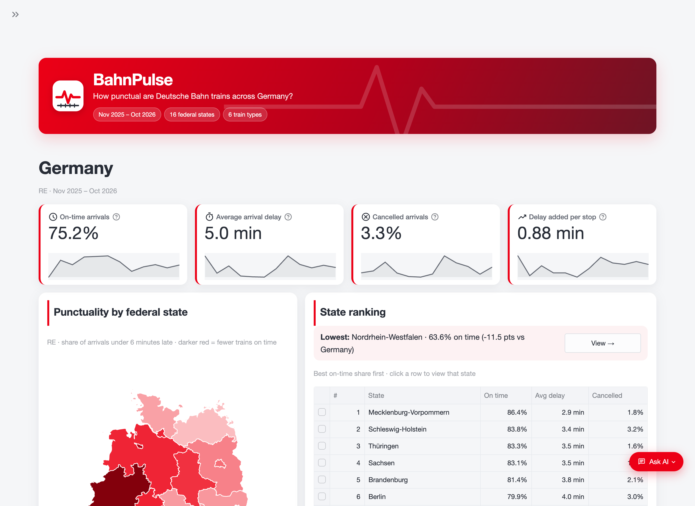
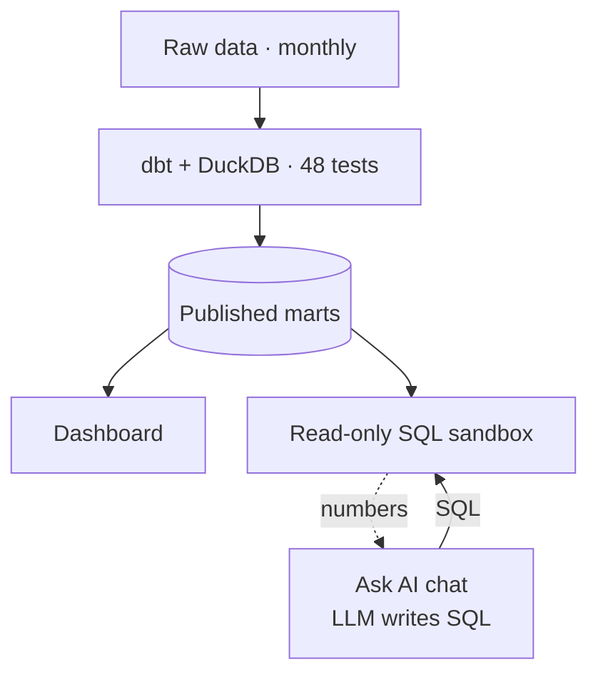
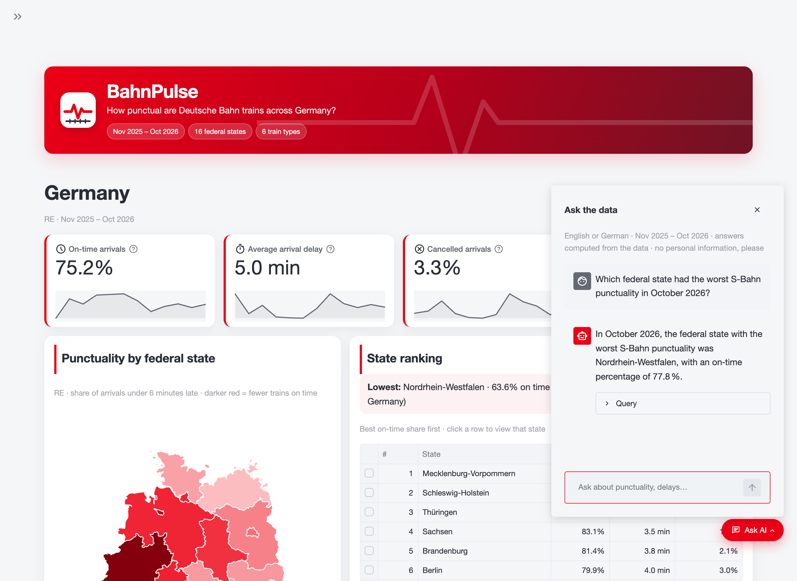

# BahnPulse: where Deutsche Bahn delays come from

[](https://github.com/Rony-crypto/bahnpulse/actions/workflows/ci.yml)
[](https://github.com/Rony-crypto/bahnpulse/actions/workflows/monthly_history.yml)
[](https://bahnpulse.streamlit.app/?embed=true)


How punctual are German trains, and where does their delay actually come from? BahnPulse
turns over 170 million stop records (every station and operator, monthly since Nov 2025) into a
tested dbt model and a public dashboard that compares federal states, train types and
stations, and traces how delay builds up along each journey.

**Live dashboard:** [bahnpulse.streamlit.app](https://bahnpulse.streamlit.app/?embed=true)



## Key findings

1. **Delay builds up along the route.** 82% of ICE trains leave their first station on time,
   but only 45% reach their last station on time.
2. **Long-distance and local trains lose time in different places.** ICE and IC/EC trains pick
   up about 60% of their delay *between* stations; S-Bahn trains pick up half of theirs while
   *standing* at stations.
3. **A few hubs matter most.** The 5% of stations that add the most delay handle 27% of train
   stops but add 35% of all delay minutes (Frankfurt, Hamburg, Köln, Hannover, Stuttgart,
   Duisburg).

Each finding holds in every one of the 12 months through Oct 2026. Method, checks and limits
are in [docs/report_notes.md](docs/report_notes.md); every measure (on time, cancelled, delay
added per stop, ...) is explained in plain language in [docs/definitions.md](docs/definitions.md).

## Questions the dashboard answers

1. How punctual is each federal state, station and train type (ICE, IC/EC, RE, RB, S-Bahn),
   and how many arrivals are cancelled?
2. Where do delays start and how do they spread along the route?
3. When are trains late (hour × weekday), and how does punctuality change month to month?
4. Hamburg deep dive: train types at one station, stations and lines, week by week.

## How it works



- **Ingest:** each month the raw stop history (S1, about 600 MB per month) and DB station data
  (S3) are downloaded (`src/dbp/ingest/`).
- **dbt + DuckDB:** staging and classification views, a stop-event fact table with station,
  train type, line, date and hour dimensions, and aggregate marts for the dashboard. The
  "where do delays start" marts are dbt Python models that rebuild trips one month at a time
  (`src/dbp/transform/delay_spread.py`). Every model and column is documented in
  `dbt/models/schema.yml`.
- **Tests:** 48 dbt data tests (keys, accepted values, full weeks, delay buckets adding up,
  delay sources adding up to the final delay) and 69 Python unit tests (`uv run pytest`),
  including the AI layer's sandbox, fallback and scoring (no API key needed).
- **Automation:** the `monthly_history` GitHub workflow checks daily for a new source month,
  then rebuilds, tests and publishes the marts; nothing is published if a test fails. The `ci`
  workflow runs lint, unit tests, `dbt parse` and a secret scan on every push.
- **Serving:** the dashboard reads only the small published marts (about 4 MB), so it runs on
  Streamlit Community Cloud's free tier and redeploys on every push.
- **Live collector (tested experiment):** `collect_hubs` fetched DB's real-time feed for six
  Hamburg hubs every hour. The test showed hourly snapshots catch every train and that delay
  forecasts read before arrival are too optimistic (91% vs 74% on time); the live layer is
  deferred. Findings: [docs/report_notes.md](docs/report_notes.md#live-hub-data-deferred).

### Data decisions worth knowing

- **Punctuality uses real arrival times.** The source's `delay_in_min` is the departure delay
  at every stop except the last, so arrival delay is derived from the timestamps (DB measures
  punctuality on arrivals).
- **Cancellations are counted on planned arrivals,** so each lost train is counted once, at
  the station it no longer reached. Counting "arrival or departure cancelled" counts a
  cut-short trip twice; counting only fully cancelled stops misses trains that start late on
  their route.
- **Train types follow the line name** (RE1, RB26, S3), not the operator code. One operator
  often runs both RE and RB lines, so grouping by code misfiled about a quarter to a third of
  regional trains; a dbt test now flags codes whose trains contradict their mapping.
- **Trips are rebuilt from stop events,** because the source has no trip id. Only trips from
  their true first to their true last station are used to split delay, and the split is
  checked to account for every minute.

## Project structure

```
bahnpulse/
├── src/dbp/
│   ├── ingest/        # download raw data (S1, S3 via DB API), live hub collector (experiment)
│   ├── profile/       # profiling of the raw stop data
│   ├── transform/     # trip rebuilding for the "where delays start" marts
│   ├── publish/       # new-month check, export of marts for the app
│   ├── ask/           # AI chat: SQL sandbox, LLM clients, agent, evaluation
│   ├── dashboard/     # Streamlit pages, charts, theme, chat widget
│   └── bahnpulse_app.py
├── dbt/
│   ├── models/        # staging → intermediate → marts (schema.yml documents every column)
│   ├── tests/         # business-rule tests (delay split adds up, full weeks, ...)
│   └── seeds/         # train type code → train group mapping
├── tests/             # Python unit tests (pytest)
├── data/published/    # exported marts the app reads (raw data is not committed)
├── docs/              # method notes, definitions, AI evaluation, screenshots
├── config/            # Hamburg hubs, station → state overrides, state boundaries
└── .github/workflows/ # CI (lint, tests, dbt parse, secret scan) and the monthly refresh
```

## Ask the data (AI)

The dashboard's floating "Ask AI" chat (bottom right, on every page) answers questions in
English or German, including ones nobody asked before ("Which Bavarian station added the
most S-Bahn delay?").

1. An LLM turns the question into one DuckDB query over six documented views of the published
   marts, or declines when the data cannot answer (causes, weather, prices, the future).
2. The query is checked (a single SELECT on the known views, no table functions) and runs in
   an in-memory sandbox with file and network access switched off, a time limit and a row cap.
3. A failing query goes back to the model once with the error.
4. The model writes a short answer from the result rows only; the chat shows the SQL so every
   number can be checked.



**The database computes every number, never the model.** Providers are tried in order: Groq's
free plan (gpt-oss-120b, then Qwen 3.8 and gpt-oss-20b, each with its own daily allowance),
then Mistral if a key is set, then Google's Gemini and Gemma as a last resort. Code: `src/dbp/ask/`.

**Evaluation:** `uv run python -m dbp.ask.evaluate` scores the model against hand-written
reference queries (`src/dbp/ask/eval_questions.yml`): 32 tuning questions used while writing
the prompt, and 12 hold-out questions written afterwards and never used to change it. With
gpt-oss-120b (Nov 2026): **41 of 44 correct**, 31 of 32 tuning and **10 of 12 hold-out**
(the fair score), median 5.6 s per question, all 7 questions the data cannot answer declined.
The misses: one wrong share (a German question about delays over 60 minutes), one March vs
June comparison and one query that still failed after the retry. Full results:
[docs/ask_eval.md](docs/ask_eval.md).

## Quick start

```bash
git clone https://github.com/Rony-crypto/bahnpulse.git
cd bahnpulse
uv sync
cp .env.example .env   # DB API keys (station data); a Groq key for the AI chat is optional
uv run python -m dbp.ingest.download_s1 --start 2025-11 --end latest
uv run python -m dbp.ingest.download_s3
uv run dbt build --project-dir dbt --profiles-dir dbt
uv run python -m dbp.publish.export_marts
uv run streamlit run src/dbp/bahnpulse_app.py
```

The dbt build caps DuckDB at 4 GB of memory (set `BAHNPULSE_DUCKDB_MEMORY` to change it). A
full build of 12 months takes about 11 minutes on GitHub's runner; the trip rebuilding for
the "where delays start" marts takes most of it.

| Command | What it does |
| --- | --- |
| `uv run python -m dbp.profile.profile_s1` | Profiles the raw stop data (nulls, keys, quirks) |
| `uv run python -m dbp.ingest.stada_probe "Hamburg Hbf"` | Checks which station fields StaDa returns |
| `uv run python -m dbp.ingest.find_eva --write` | Looks up station numbers for `config/hubs.yml` |
| `uv run pytest` | Runs the unit tests |

## Data coverage and known gaps

History covers Nov 2025 to the latest month the source has published (updated monthly by the workflow).
Two months are incomplete, found by the dbt mart `agg_month_coverage` (hours with under half
the usual stop volume):

- **Nov 2025:** 1–2 Nov cover only the ~100 largest stations; all stations from 2 Nov.
- **Jul 2026:** overnight hours (00:00–05:00) on 7 nights were not collected, about 3% of the
  month's stops. Monthly figures barely change; the trend tooltip marks both months.

## Roadmap

| Status | Milestone |
| --- | --- |
| Done | Data foundation: download, profiling, station → state mapping |
| Done | Tested dbt model and monthly automation |
| Done | Public dashboard: states, train types, cancellations, Hamburg deep dive |
| Done | Where delays start and how they spread |
| Done | Ask AI chat: questions in English or German answered with checked SQL, evaluated |

## Credits and licences

- Historical stop data: [piebro/deutsche-bahn-data](https://huggingface.co/datasets/piebro/deutsche-bahn-data),
  CC BY 4.0, based on Deutsche Bahn Timetables API data.
- Station data: [DB API Marketplace](https://developers.deutschebahn.com/db-api-marketplace)
  (StaDa, Timetables), CC BY 4.0, Deutsche Bahn AG.
- State boundaries: [Natural Earth](https://www.naturalearthdata.com/) admin-1, public domain;
  Germany-only extract in `config/germany_states.geojson`.
- No personal data is collected or stored.

Code: MIT. Data: see credits above.
